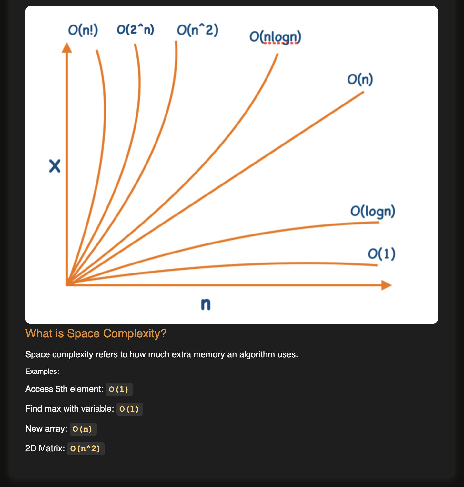

# Time and Space Complexity

## Time complexity

Time complexity describes how the number of operations an algorithm performs grows as the input size `n` grows. It is not the same as how long a program takes to run, which depends on the machine.

```
Time Complexity != Execution Time
```

**Big O** is the notation for the worst case. It keeps only the fastest-growing term and drops constants, so `3n + 5` becomes `O(n)`.

## Common complexities

From fastest to slowest:

| Big O | Name | Example |
|-------|------|---------|
| `O(1)` | Constant | Accessing `arr[5]` directly |
| `O(log n)` | Logarithmic | Binary search |
| `O(n)` | Linear | Linear search, one loop |
| `O(n log n)` | Linearithmic | Merge sort, a loop with a halving loop inside |
| `O(n^2)` | Quadratic | Two nested loops |
| `O(n^3)` | Cubic | Three nested loops |
| `O(2^n)` | Exponential | Recursive Fibonacci |
| `O(n!)` | Factorial | Generating all permutations by brute force |



## Patterns

```js
// O(1): no loop, direct access
const value = arr[5];

// O(n): runs n times
for (let i = 0; i < n; i++) {}

// O(log n): the value halves every step
let temp = n;
while (temp > 1) temp = Math.floor(temp / 2);

// O(n log n): n times a halving loop
for (let i = 0; i < n; i++) {
  let temp = n;
  while (temp > 1) temp = Math.floor(temp / 2);
}

// O(n^2): n * n
for (let i = 0; i < n; i++) {
  for (let j = 0; j < n; j++) {}
}

// O(n^3): n * n * n
for (let i = 0; i < n; i++) {
  for (let j = 0; j < n; j++) {
    for (let k = 0; k < n; k++) {}
  }
}

// O(2^n): every call makes two more calls
function fib(n) {
  if (n <= 1) return n;
  return fib(n - 1) + fib(n - 2);
}
```

## Linear search vs binary search

| | Linear search | Binary search |
|---|---|---|
| Input | Works on unsorted arrays | Only works on sorted arrays |
| How | Checks elements one by one | Cuts the search range in half each step |
| Best case | 1 operation (target at index 0) | 1 operation (middle element matches) |
| Average case | `n / 2` operations | `log2(n)` operations |
| Worst case | `n` operations (target not found) | `log2(n)` operations |
| Big O | `O(n)` | `O(log n)` |

How many loop runs each needs:

| n | Linear search | Binary search |
|--:|--:|--:|
| 10 | 10 | 3 |
| 100 | 100 | 7 |
| 1000 | 1000 | 10 |

As `n` grows, linear search grows at the same rate, but binary search barely grows at all.

## Space complexity

Space complexity is how much **extra** memory an algorithm uses as the input grows.

| Example | Space |
|---------|-------|
| Access the 5th element | `O(1)` |
| Find the max using one variable | `O(1)` |
| Create a new array of size `n` | `O(n)` |
| Create an `n x n` matrix | `O(n^2)` |

## Lesson screenshots

1. [What is time complexity, linear search](lesson/01-what-is-time-complexity-linear-search.png)
2. [Binary search, Big O, O(1)](lesson/02-binary-search-big-o-o1.png)
3. [O(n), O(log n), O(n^2) examples](lesson/03-on-ologn-on2-examples.png)
4. [O(n log n), O(n^3), O(2^n) examples](lesson/04-onlogn-on3-o2n-examples.png)
5. [O(n!) and the order of complexities](lesson/05-on-factorial-and-priorities.png)
6. [Growth graph and space complexity](lesson/06-growth-graph-space-complexity.png)

## Quiz: DSA Time Complexity (2026-11-10)

Score: 5 / 6

| # | Question | My answer | Result |
|---|----------|-----------|:------:|
| 1 | [Why can linear search become inefficient for large datasets?](quiz/q1-linear-search-large-inputs.png) | B, C | ❌ |
| 2 | [Time complexity of a single loop](quiz/q2-single-loop.png) | `O(n)` | ✅ |
| 3 | [Correct observations about binary search](quiz/q3-binary-search.png) | A, B, C | ✅ |
| 4 | [Time complexity of two nested loops](quiz/q4-nested-loop.png) | `O(n^2)` | ✅ |
| 5 | [Why a loop with a halving loop inside is `O(n log n)`](quiz/q5-loop-with-halving.png) | A, B, C | ✅ |
| 6 | [Time complexity of three nested loops](quiz/q6-triple-nested-loop.png) | `O(n^3)` | ✅ |

### What I got wrong (Q1)

I picked B (operations grow with input size) and C (the target may be near the end), but missed **A: the algorithm may need to process many elements before completion**. A is the core reason: in the worst case linear search visits every one of the `n` elements, and that is what makes it `O(n)`. B and C are true for the same reason. D (halving the search space) describes binary search, not linear search.

**Lesson:** for multiple-select questions, check every option on its own. If a statement is true, select it, even when it sounds like a rewording of another option.
