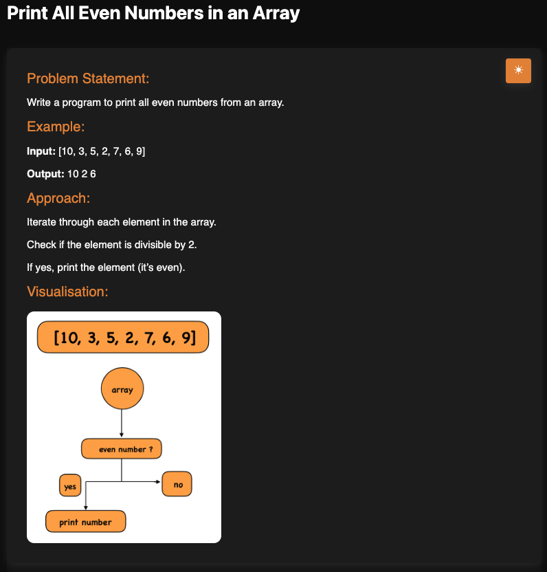

# Print All Even Numbers in an Array

**Topic:** Arrays · **Difficulty:** Easy

## Problem

Given an array of numbers, print every even number in it.



## Approach

1. Go through each element of the array.
2. If the element is divisible by 2 (`num % 2 === 0`), it is even, so print it.
3. Otherwise skip it.

**Example:** `[10, 3, 5, 2, 7, 6, 9]` → `10 2 6`

## Complexity

- **Time:** O(n), each element is checked once
- **Space:** O(1) for the loop in JS; O(k) in TS, which collects the k even numbers into a new array

## Run

```bash
npx tsx solution.ts   # TypeScript
node solution.js      # JavaScript
```
