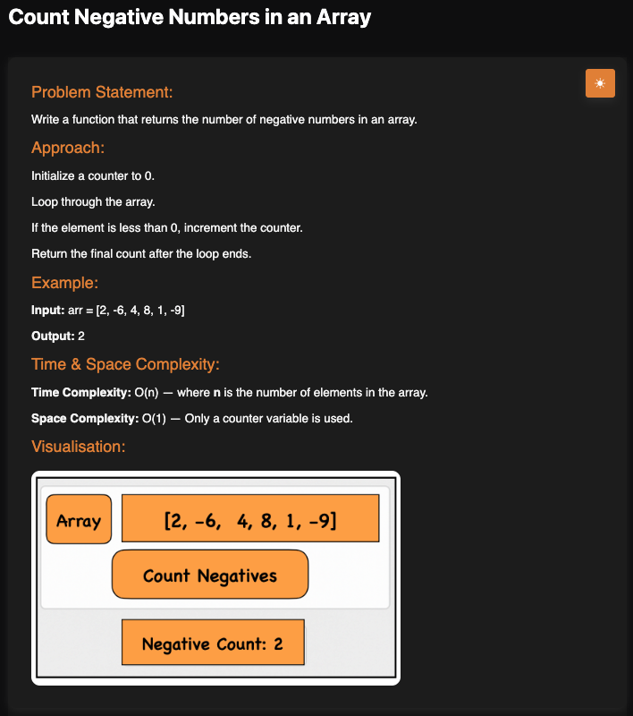

# Count Negative Numbers

**Topic:** Arrays · **Difficulty:** Easy

## Problem

Write a function that returns the number of negative numbers in an array.



## Approach

1. Start a counter at `0` inside the function, before the loop, so every call starts fresh and the counter survives the whole loop.
2. Go through each element; if it is less than `0`, increase the counter. `0` itself is not negative.
3. After the loop, return the counter.

**Example:** `[2, -6, 4, 8, 1, -9]` → `2`

## Complexity

- **Time:** O(n), each element is checked once
- **Space:** O(1)

## Run

```bash
npx tsx solution.ts   # TypeScript
node solution.js      # JavaScript
```
