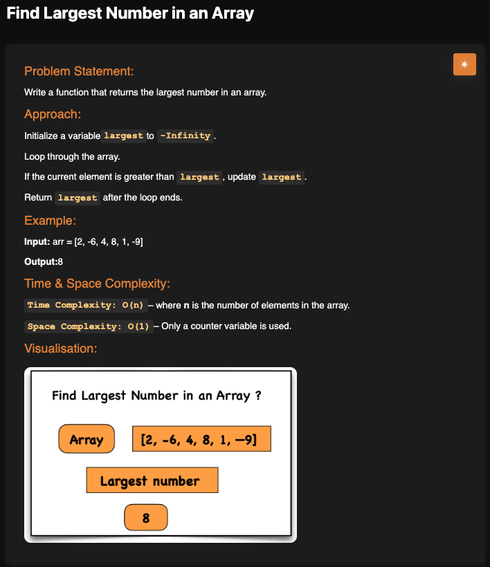

# Largest Number in an Array

**Topic:** Arrays · **Difficulty:** Easy

## Problem

Write a function that returns the largest number in an array.



## Approach

1. Start `largest` at `Number.NEGATIVE_INFINITY`, which is smaller than any number. Starting at `0` would give the wrong answer for an all-negative array such as `[-5, -2, -9]`.
2. Go through each element; if it is bigger than `largest`, it becomes the new `largest`.
3. After the loop, return `largest`. An empty array returns `-Infinity`.

**Example:** `[2, -6, 4, 8, 1, -9]` → `8`

## Complexity

- **Time:** O(n), each element is checked once
- **Space:** O(1)

## Run

```bash
npx tsx solution.ts   # TypeScript
node solution.js      # JavaScript
```
