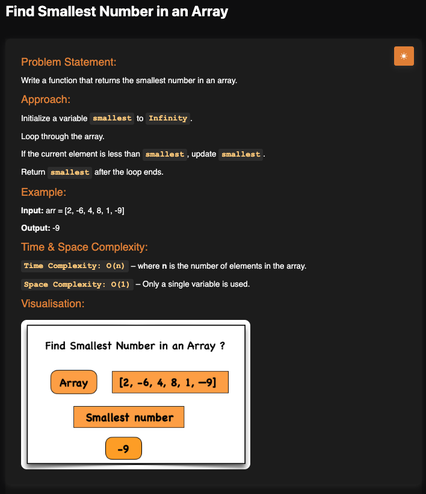

# Smallest Number in an Array

**Topic:** Arrays · **Difficulty:** Easy

## Problem

Write a function that returns the smallest number in an array.



## Approach

1. Start `smallest` at `Infinity`, which is larger than any number. Starting at `0` would give the wrong answer for an all-positive array such as `[2, 4, 8]`.
2. Go through each element; if it is less than `smallest`, it becomes the new `smallest`.
3. After the loop, return `smallest`. An empty array returns `Infinity`.

**Example:** `[2, -6, 4, 8, 1, -9]` → `-9`

## Complexity

- **Time:** O(n), each element is checked once
- **Space:** O(1)

## Run

```bash
npx tsx solution.ts   # TypeScript
node solution.js      # JavaScript
```
