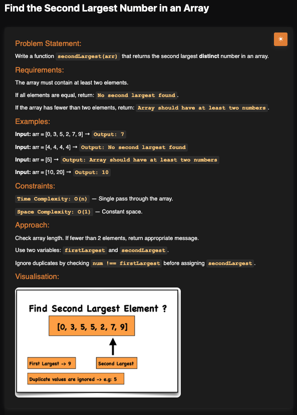

# Second Largest Number in an Array

**Topic:** Arrays · **Difficulty:** Easy

## Problem

Return the second largest **distinct** number in an array. If the array has fewer than two elements, return `Array should have at least two numbers`; if all elements are equal, return `No second largest found`.



## Approach

1. If the array has fewer than 2 elements (this includes an empty array), return the "at least two numbers" message.
2. Keep two variables, `firstLargest` and `secondLargest`, both starting at `-Infinity`.
3. For each number:
   - Bigger than `firstLargest` → the old `firstLargest` moves down to `secondLargest`, and the number becomes `firstLargest`.
   - Otherwise, bigger than `secondLargest` and not equal to `firstLargest` → it becomes `secondLargest`. The `!==` check skips duplicates of the largest.
4. After the loop, if `secondLargest` is still `-Infinity`, no distinct second value was found (e.g. `[4, 4, 4]`), so return `No second largest found`. As with linear search, "not found" can only be decided once the loop has finished.

**Example:** `[0, 3, 5, 2, 7, 9]` → `7`; `[4, 4, 4]` → `No second largest found`; `[5]` → `Array should have at least two numbers`

## Complexity

- **Time:** O(n), a single pass through the array
- **Space:** O(1), only two variables

## Run

```bash
npx tsx solution.ts   # TypeScript
node solution.js      # JavaScript
```
