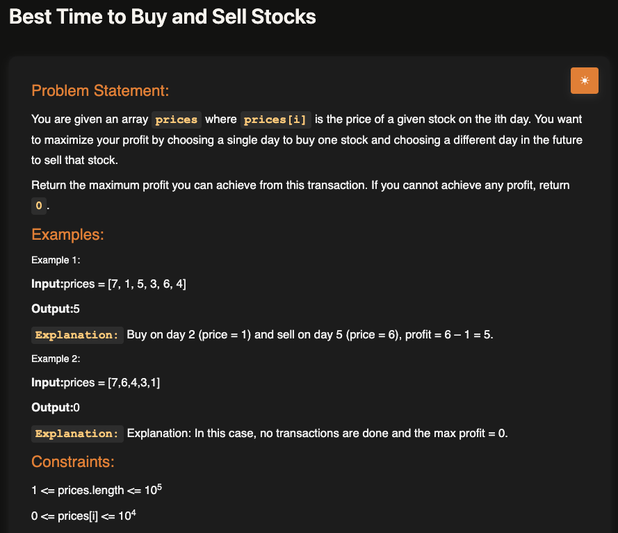
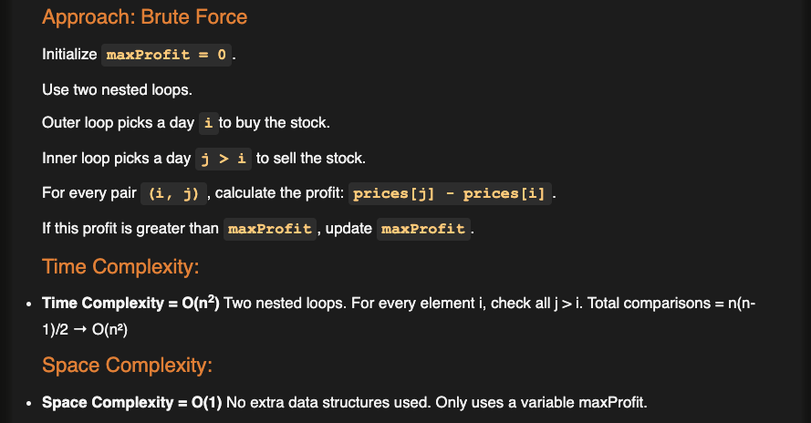
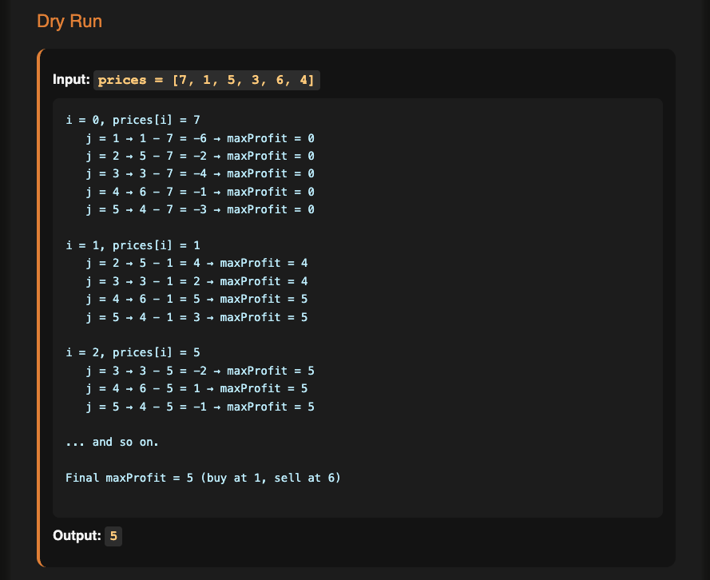
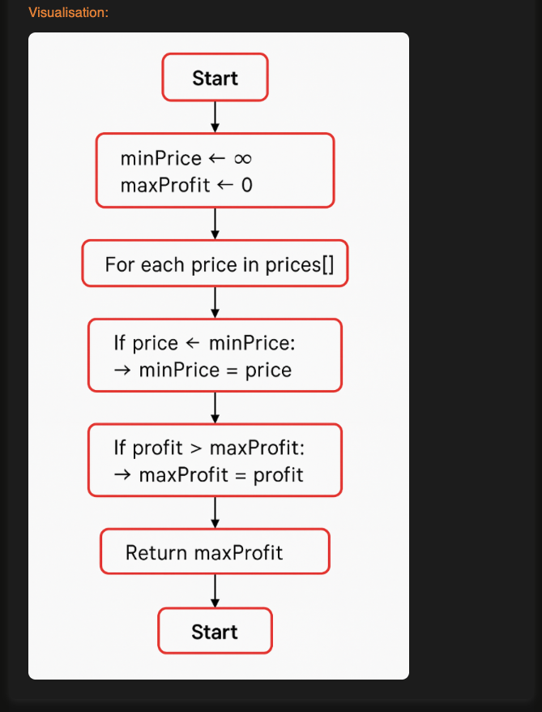

# Best Time to Buy and Sell Stocks

**Topic:** Arrays · **Difficulty:** Easy

## Problem

Given each day's stock price, buy on one day and sell on a later day to make the largest profit. Return that profit, or `0` if no trade makes money.









## Approach

**Pattern:** brute force over every pair (nested loops)

1. Start with `maxProfit = 0`, so a falling market returns `0`.
2. The outer loop picks a buy day `i`.
3. The inner loop picks every later sell day `j > i` (selling must come after buying).
4. If `prices[j] - prices[i]` beats `maxProfit`, keep it.

**Next step:** the visualisation shows the O(n) version. Track the lowest price seen so far and, for each day, check the profit from selling at today's price. This is the same running-min idea as [smallest number in an array](../05-smallest-number-in-an-array).

**Example:** `[7, 1, 5, 3, 6, 4]` → `5` (buy at 1, sell at 6); `[7, 6, 4, 3, 1]` → `0`

## Complexity

- **Time:** O(n²), n(n-1)/2 pairs
- **Space:** O(1), one variable

## Run

```bash
npx tsx solution.ts   # TypeScript
node solution.js      # JavaScript
```
