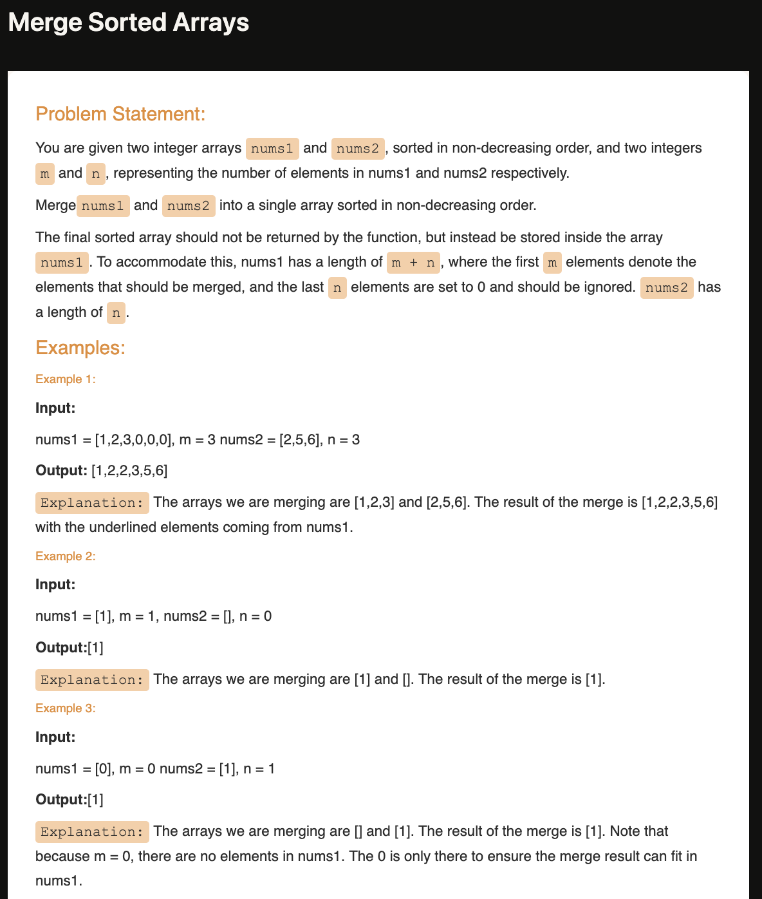
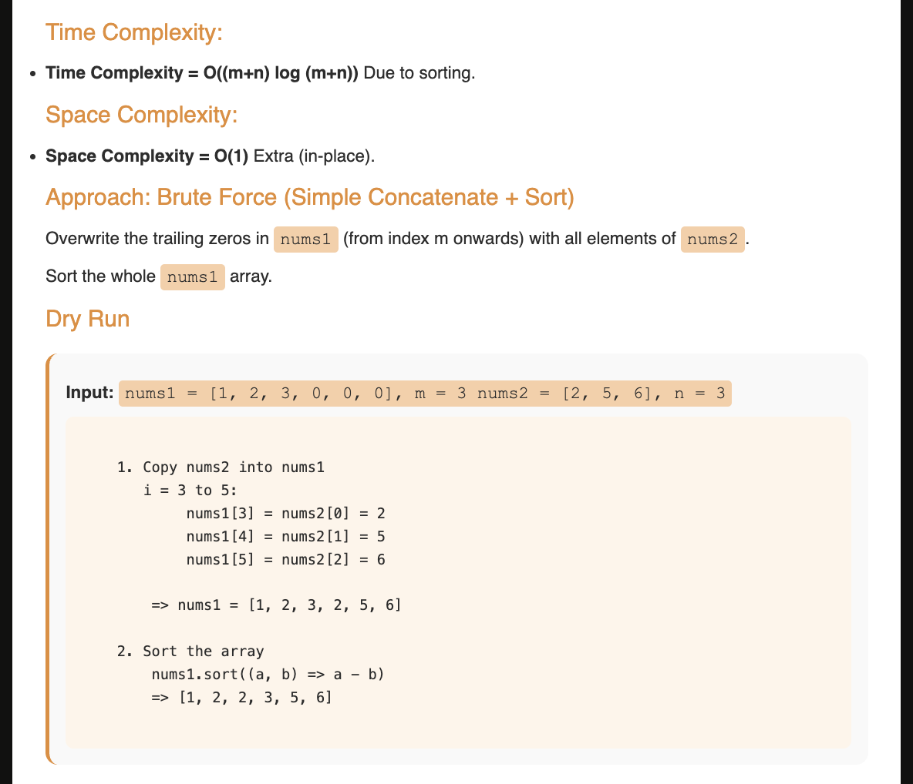
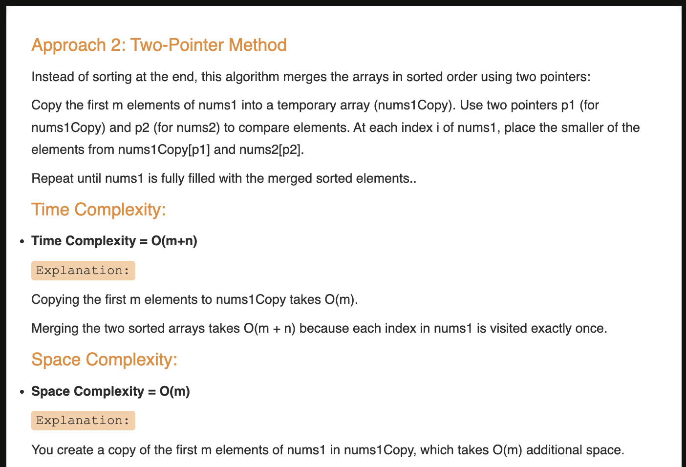
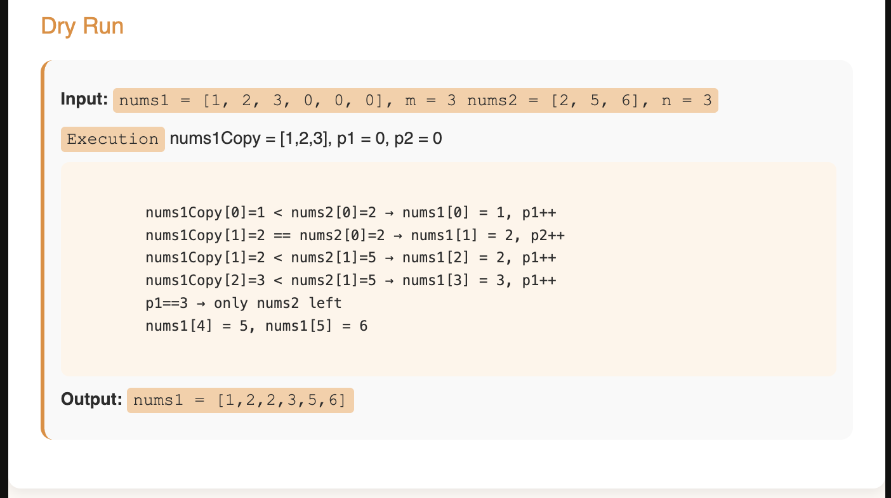

# Merge Sorted Arrays

**Topic:** Arrays · **Difficulty:** Easy

## Problem

Two arrays are already sorted. `nums1` has `m` real values followed by `n` zeros as empty space; `nums2` has `n` values. Merge `nums2` into `nums1` **in place** so the whole of `nums1` ends up sorted. Nothing is returned.









## Approach 1: copy then sort ([solution.ts](solution.ts) · [solution.js](solution.js))

**Pattern:** brute force

1. Copy `nums2` into the empty slots at the end of `nums1`: slot `i` (from `m` to `m + n - 1`) gets `nums2[i - m]`.
2. Sort the whole of `nums1` with `sort((a, b) => a - b)`.

Two things worth remembering:

- **The compare function matters.** Without it, `sort` compares numbers as text, so `[10, 9, 1].sort()` gives `[1, 10, 9]`. `a - b` sorts small to big; `b - a` sorts big to small. `sort` changes the array itself, which is exactly what this problem wants.
- **Nothing is returned**, so `console.log(merge(...))` prints `undefined`. Call the function, then print `nums1`.

What I fixed along the way: the parameter was named `num2` while the loop read `nums2`. It only worked because a global `nums2` existed; called with any other array, it threw `ReferenceError: nums2 is not defined`.

## Approach 2: two pointers ([solution-two-pointers.ts](solution-two-pointers.ts) · [solution-two-pointers.js](solution-two-pointers.js))

**Pattern:** two pointers, one per sorted array (the merge step of merge sort)

Approach 1 ignores that both arrays are already sorted. Here the smallest remaining value is always at the front of one of the two arrays, so I only compare those two.

1. Copy the real part of `nums1` (`slice(0, m)`) into `nums1Copy`, so writing into `nums1` can't overwrite values I haven't read yet.
2. `p1` points into `nums1Copy`, `p2` into `nums2`, both starting at `0`.
3. For each slot `i` of `nums1`, take from `nums1Copy` if `nums2` is used up, or if `nums1Copy` still has values and its value is smaller; otherwise take from `nums2`. Move the pointer I took from.

The order inside the `if` matters: `p2 >= n || (p1 < m && ...)` checks that a pointer is still in range **before** reading its value, so one array running out is handled without a separate loop.

Trace for `[1,2,3]` + `[2,5,6]`: take 1 (copy) → 2 (nums2, tie goes to nums2) → 2 (copy) → 3 (copy) → copy used up → 5, 6.

**Even better (LeetCode 88):** fill `nums1` from the **back** with the larger value each time. The empty slots are at the end, so nothing gets overwritten and the copy isn't needed: O(1) extra space.

**Example:** `[1,2,3,0,0,0]`, m = 3 + `[2,5,6]`, n = 3 → `[1,2,2,3,5,6]`; `[0]`, m = 0 + `[1]` → `[1]`

## Complexity

| Approach | Time | Extra space |
|---|---|---|
| 1. Copy then sort | O((m + n) log(m + n)), the sort dominates | O(1) |
| 2. Two pointers | O(m + n), each slot filled once | O(m), the copy of `nums1` |

## Run

```bash
npx tsx solution.ts                # Approach 1, TypeScript
node solution.js                   # Approach 1, JavaScript
npx tsx solution-two-pointers.ts   # Approach 2, TypeScript
node solution-two-pointers.js      # Approach 2, JavaScript
```
