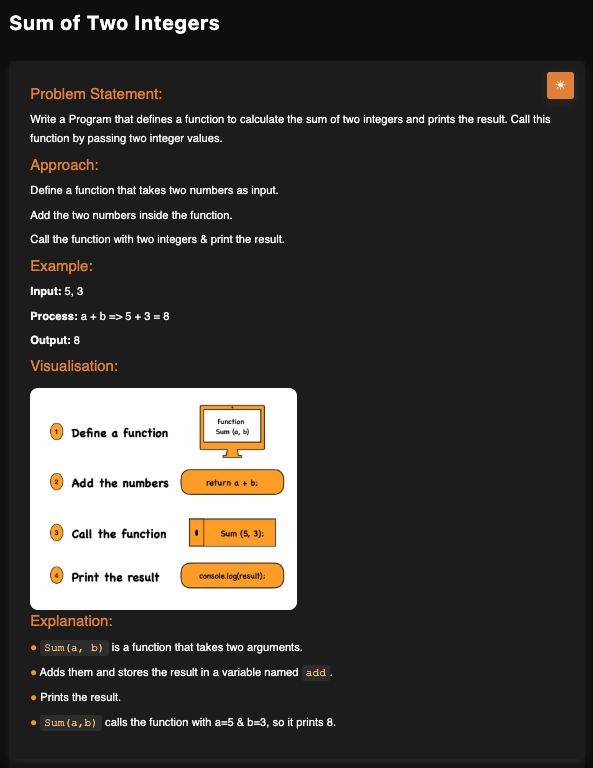

# Sum of Two Integers

**Topic:** Basics · **Difficulty:** Easy

## Problem

Write a function that calculates the sum of two integers and prints the result.



## Approach

Define a function that takes two numbers, add them and print the result.

**Example:** `5, 3` → `8`

## Complexity

- **Time:** O(1)
- **Space:** O(1)

## Run

```bash
npx tsx solution.ts   # TypeScript
node solution.js      # JavaScript
```
