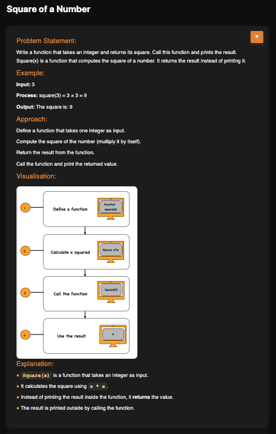

# Square of a Number

**Topic:** Basics · **Difficulty:** Easy

## Problem

Write a function that takes an integer and returns its square, then print the result.



## Approach

Multiply the number by itself and **return** the result instead of printing it inside the function, so the caller decides what to do with it.

**Example:** `3` → `9`

## Complexity

- **Time:** O(1)
- **Space:** O(1)

## Run

```bash
node solution.js
```
