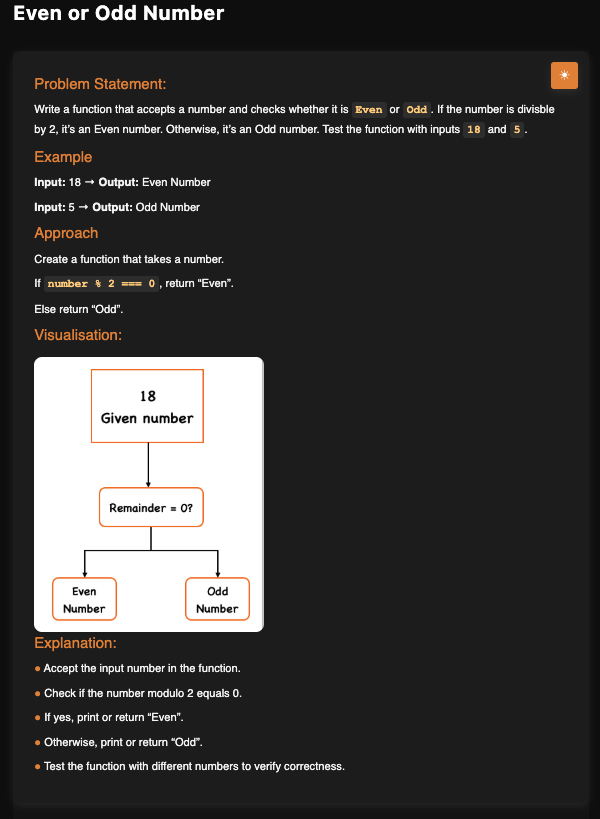

# Even or Odd Number

**Topic:** Basics · **Difficulty:** Easy

## Problem

Write a function that checks whether a number is even or odd.



## Approach

Use the modulo operator: if `num % 2 === 0` the number is even, otherwise it is odd.

**Example:** `18` → `Even`, `5` → `Odd`

## Complexity

- **Time:** O(1)
- **Space:** O(1)

## Run

```bash
node solution.js
```
