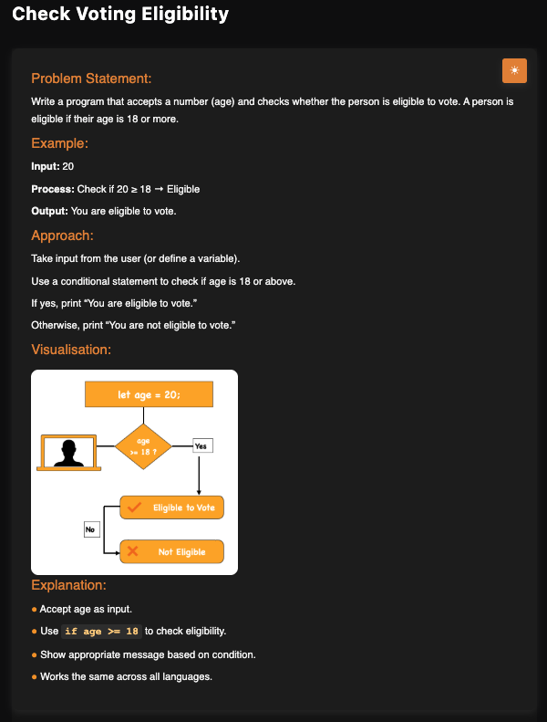

# Check Voting Eligibility

**Topic:** Basics · **Difficulty:** Easy

## Problem

Given an age, check whether the person is eligible to vote (age 18 or more).



## Approach

Use an `if / else if / else` chain:

1. Age below 0 → invalid input
2. Age below 18 → not eligible
3. Otherwise → eligible

**Example:** `20` → `Eligible to Vote`

## Complexity

- **Time:** O(1)
- **Space:** O(1)

## Run

```bash
npx tsx solution.ts   # TypeScript
node solution.js      # JavaScript
```
