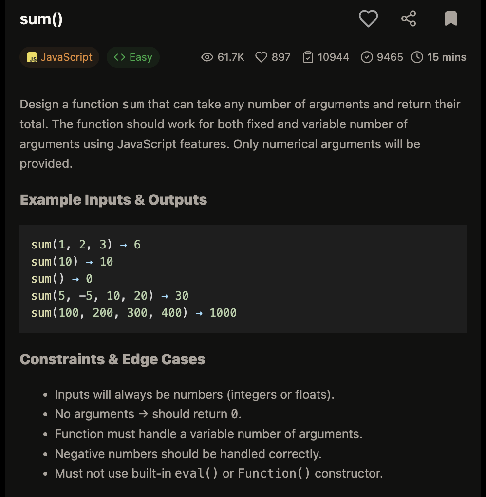

# Sum of Any Number of Arguments

**Topic:** Basics · **Difficulty:** Easy

## Problem

Write a `sum` function that accepts any number of numeric arguments, including none, and returns their total. Unlike [sum of two integers](../01-sum-of-two-integers), the number of inputs isn't fixed.



## Approach

**New concept:** rest parameters (`...args`)

1. Declare the parameter as `...args`. JavaScript collects every argument passed into one real array, so `sum(1, 2, 3)` gives `args = [1, 2, 3]` and `sum()` gives `args = []`.
2. Start `total` at `0`.
3. Loop over `args` with `for...of` and add each number to `total`.
4. Return `total`. With no arguments the loop never runs, so the result is `0`, which handles the empty case for free.

Rest parameters must be the last parameter (`function f(first, ...rest)` is fine, `function f(...rest, last)` is not). They replace the older `arguments` object, which is array-like but not a real array and doesn't exist in arrow functions.

The TypeScript version types the rest parameter as `...numbers: number[]` and uses `reduce((total, n) => total + n, 0)`. The `0` is the starting value; without it, `sum()` would throw on an empty array.

**Example:** `sum(1, 2, 3)` → `6`; `sum()` → `0`; `sum(5, -5, 10, 20)` → `30`

## Complexity

- **Time:** O(n), one step per argument
- **Space:** O(n) for the `args` array the rest parameter creates

## Run

```bash
npx tsx solution.ts   # TypeScript
node solution.js      # JavaScript
```
