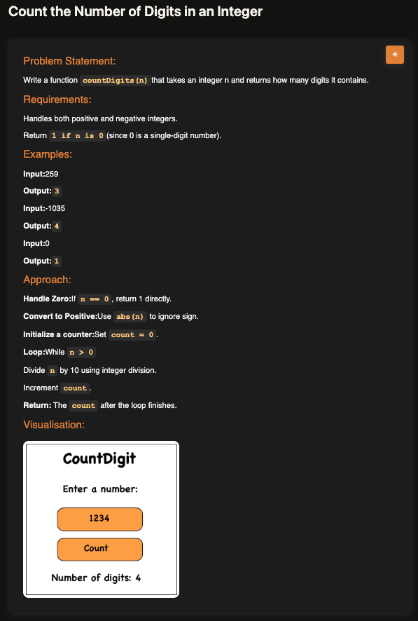

# Count Digits

**Topic:** Math · **Difficulty:** Easy

## Problem

Write a function that returns how many digits an integer has. It must work for negative numbers, and `0` counts as one digit.



## Approach

**Pattern:** digit extraction with a `while` loop (divide by 10 until nothing is left)

1. Take the absolute value, so the minus sign doesn't matter: `-1035` → `1035`.
2. If the number is `0`, return `1`. The loop below would never run for `0`, so it needs its own case.
3. While the number is greater than `0`, drop its last digit with `Math.floor(n / 10)` and add one to `count`.
4. When the number reaches `0`, `count` is the number of digits.

Each division removes exactly one digit: `1035 → 103 → 10 → 1 → 0` is 4 steps, so 4 digits.

**Example:** `259` → `3`; `-1035` → `4`; `0` → `1`

## Complexity

- **Time:** O(d), one step per digit (d = number of digits, which grows like log₁₀ n)
- **Space:** O(1)

## Run

```bash
npx tsx solution.ts   # TypeScript
node solution.js      # JavaScript
```
