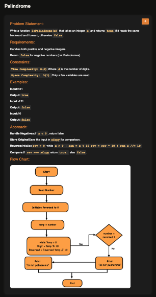

# Palindrome Number

**Topic:** Math · **Difficulty:** Easy

## Problem

Write a function that returns `true` if an integer reads the same forwards and backwards, and `false` otherwise. Negative numbers are never palindromes.



## Approach

**Pattern:** reverse a number digit by digit (`% 10` takes the last digit, `Math.floor(/ 10)` drops it)

1. If the number is negative, return `false`: `-121` reversed would be `121-`.
2. Keep a copy of the original, and start `reversed` at `0`.
3. While the number is greater than `0`:
   - take its last digit: `num % 10`
   - add it to the end of `reversed`: `reversed * 10 + lastDigit`
   - drop the last digit: `Math.floor(num / 10)`
4. Compare `reversed` with the original.

Trace for `121`: `reversed` goes `0 → 1 → 12 → 121` while `num` goes `121 → 12 → 1 → 0`, so it's a palindrome.

**The bug I fixed:** `num = num / 10` without `Math.floor` turns `121` into `12.1`, `1.21`, `0.121`, … so the loop runs hundreds of times on decimals and `reversed` is never right. It only looked correct when testing a non-palindrome (`1234` → `false`), so always test a case that should be `true` as well.

**Example:** `121` → `true`; `-121` → `false`; `10` → `false`

## Complexity

- **Time:** O(d), one step per digit
- **Space:** O(1)

## Run

```bash
npx tsx solution.ts   # TypeScript
node solution.js      # JavaScript
```
