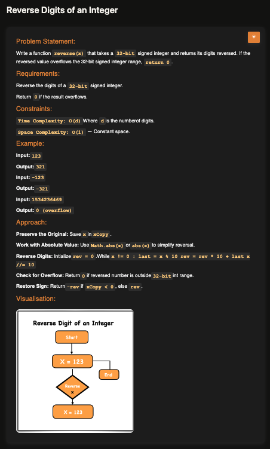

# Reverse Integer

**Topic:** Math · **Difficulty:** Easy

## Problem

Reverse the digits of a 32-bit signed integer, keeping its sign. If the reversed number doesn't fit in the 32-bit range, return `0`.



## Approach

**Pattern:** reverse a number digit by digit (as in [palindrome number](../02-palindrome-number)) + a range check on the result

1. Keep the original, and work with its absolute value so the sign doesn't get in the way.
2. Reverse the digits: take the last digit with `% 10`, append it with `reversed * 10 + lastDigit`, drop it with `Math.floor(/ 10)`.
3. **After the loop**, check the reversed value against the 32-bit range, **−2³¹ to 2³¹ − 1** (`-2147483648` to `2147483647`). Return `0` if it's outside.
4. Put the sign back: `-reversed` if the original was negative.

Things I got wrong along the way:

- **Checking the input instead of the result.** The input is always a valid 32-bit number; it's the reversed value that can overflow. `1534236469` fits, but reversed it's `9646324351`, which doesn't.
- **`limit + 1` instead of `limit - 1`.** The range isn't symmetric: the largest value is 2³¹ − 1.
- **Checking `num` after the loop.** The loop only ends when `num` reaches `0`, so that check could never fail. The check has to use the reversed value.

**Interview follow-up:** LeetCode 7 (Reverse Integer) says to assume you can't store anything bigger than 32 bits, so in Java or C++ `reversed * 10` would overflow *inside* the loop. The fix there is to check *before* multiplying whether `reversed` is already too big. JavaScript numbers hold much larger values, so checking after the loop works here.

The TypeScript version applies the sign first and then checks the signed value against both limits, which is exact at the edges (`-2147483648` is allowed, `+2147483648` isn't).

**Example:** `123` → `321`; `-123` → `-321`; `1534236469` → `0` (overflow)

## Complexity

- **Time:** O(d), one step per digit
- **Space:** O(1)

## Run

```bash
npx tsx solution.ts   # TypeScript
node solution.js      # JavaScript
```
