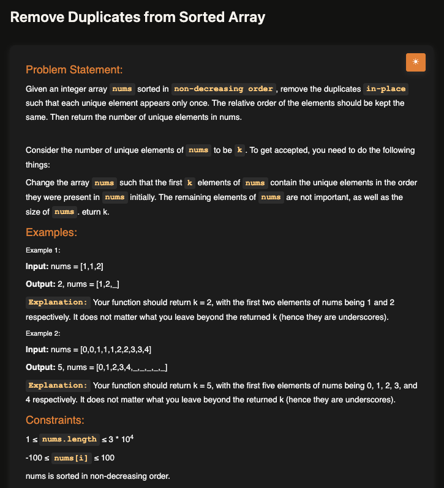
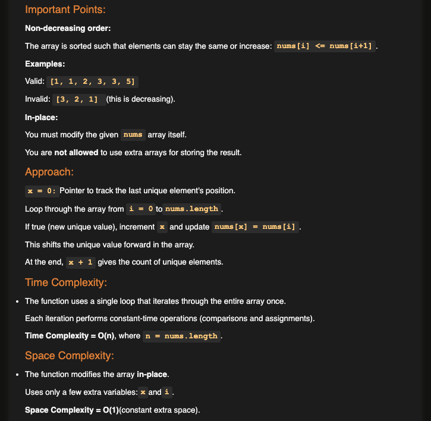
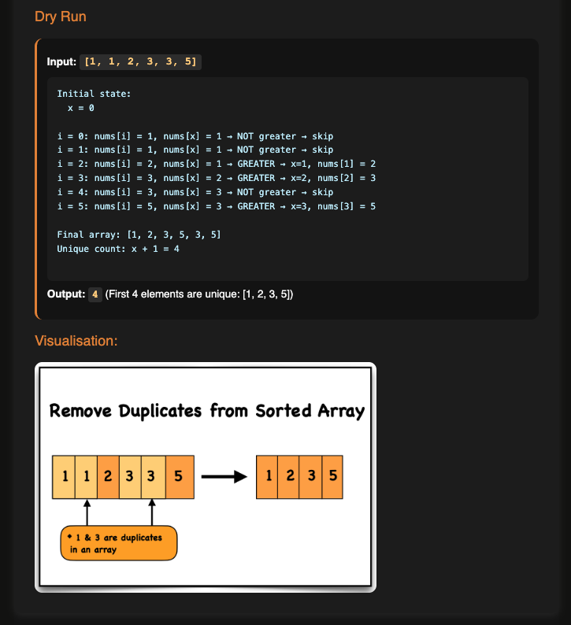

# Remove Duplicates from Sorted Array

**Topic:** Two Pointers · **Difficulty:** Easy

## Problem

Given an array sorted in non-decreasing order, remove the duplicates **in place** so each value appears once at the front of the array, keeping their order, and return how many unique values there are (`k`). Whatever is left after the first `k` elements doesn't matter, and no extra array is allowed.







## Approach

**Pattern:** two pointers, slow and fast (read/write) on the same array

- `x` (slow) points at the **last unique value kept** at the front.
- `i` (fast) **scans every element**.

1. Start with `x = 0`: the first element is always unique.
2. For each `i`, compare `a[i]` with `a[x]`. Because the array is sorted, a new value is always bigger than the last unique one.
3. If it's bigger, it's a new unique value: move `x` forward one step and copy it there, `a[x] = a[i]`.
4. Otherwise it's a duplicate: skip it, and only `i` moves on.
5. At the end, `x + 1` is the number of unique values.

Dry run for `[1, 1, 2, 3, 3, 5]`: `x` stops on each new value (1 → 2 → 3 → 5) and the front of the array becomes `[1, 2, 3, 5, 3, 5]`, so `k = 4`.

Why it's O(1) space: instead of building a new array, the unique values are written over the duplicates in the same array. The sorting is what makes one pass enough: duplicates are always next to each other.

**Example:** `[1, 1, 2]` → `2` (`[1, 2, _]`); `[0, 0, 1, 1, 1, 2, 2, 3, 3, 4]` → `5` (`[0, 1, 2, 3, 4, _, …]`)

## Complexity

- **Time:** O(n), one pass through the array
- **Space:** O(1), only two index variables (see my [time and space complexity notes](../../../notes/fundamentals/01-time-and-space-complexity))

## Run

```bash
npx tsx solution.ts   # TypeScript
node solution.js      # JavaScript
```
