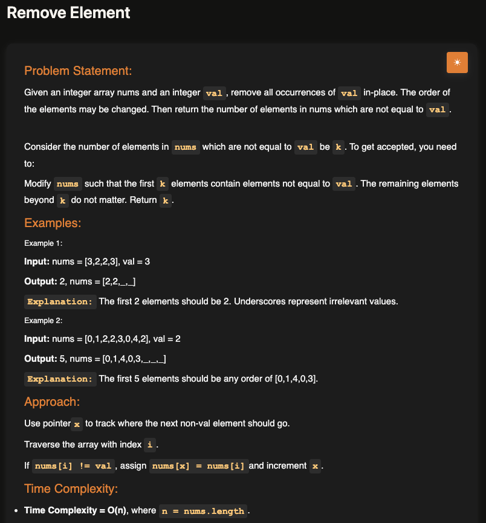
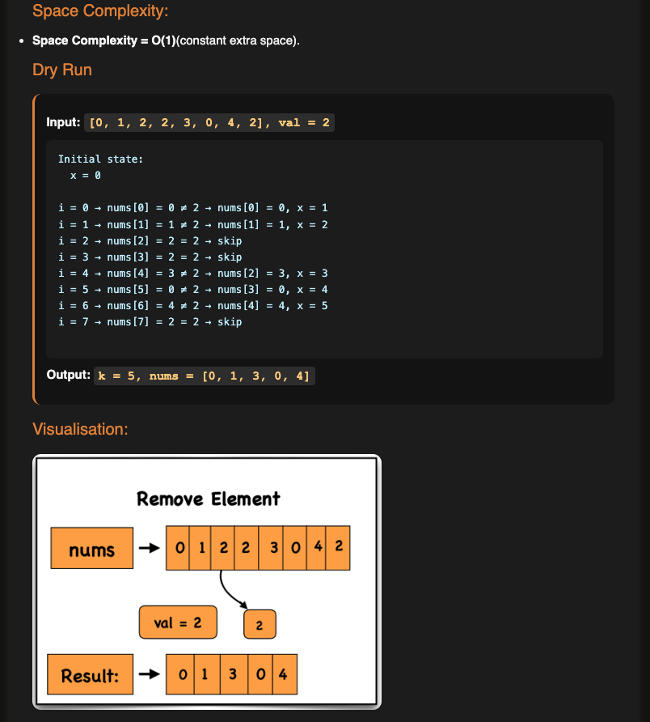

# Remove Element

**Topic:** Two Pointers · **Difficulty:** Easy

## Problem

Remove every occurrence of a value `val` from an array **in place**, moving the other values to the front, and return how many values are left (`k`). What's after the first `k` elements doesn't matter, and the order may change.





## Approach

**Pattern:** two pointers, slow and fast (read/write) on the same array

- `x` (slow) is **where the next value to keep goes**.
- `i` (fast) **scans every element**.

1. Start with `x = 0`.
2. For each `i`: if `nums[i] !== val`, it should be kept, so copy it to `nums[x]` and move `x` forward.
3. If it equals `val`, skip it: only `i` moves on.
4. At the end, `x` is the number of values kept.

Dry run for `[0, 1, 2, 2, 3, 0, 4, 2]`, `val = 2`: the 2s are skipped and `0, 1, 3, 0, 4` are written to the front, so `k = 5`.

**Compared with [remove duplicates](../01-remove-duplicates-from-sorted-array):** same slow/fast pointers, two small differences.

| | Remove duplicates | Remove element |
|---|---|---|
| Keep a value when | it's bigger than the last kept one (needs a sorted array) | it isn't `val` (any order works) |
| `x` means | index of the **last** kept value | index where the **next** kept value goes |
| Order of steps | move `x`, then write | write, then move `x` |
| Return | `x + 1` | `x` |

**Example:** `[3, 2, 2, 3]`, `val = 3` → `2` (`[2, 2, _, _]`); `[0, 1, 2, 2, 3, 0, 4, 2]`, `val = 2` → `5` (`[0, 1, 3, 0, 4, _, _, _]`)

## Complexity

- **Time:** O(n), one pass
- **Space:** O(1), two index variables (see my [time and space complexity notes](../../../notes/fundamentals/01-time-and-space-complexity))

## Run

```bash
npx tsx solution.ts   # TypeScript
node solution.js      # JavaScript
```
