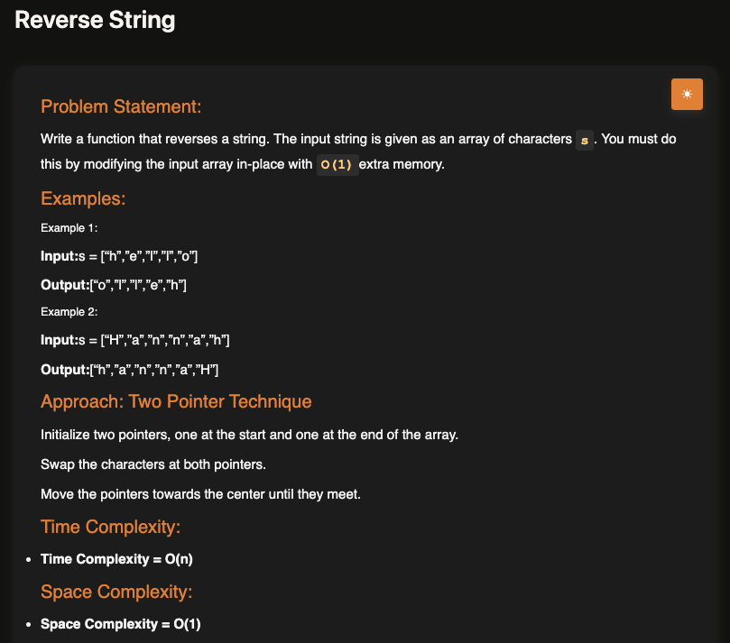
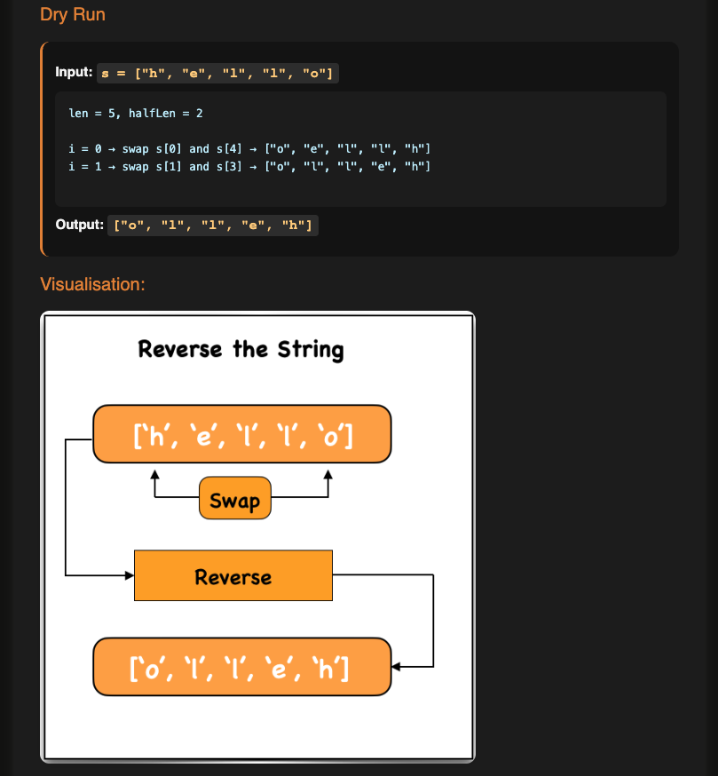

# Reverse String

**Topic:** Two Pointers · **Difficulty:** Easy

## Problem

Reverse a string that is given as an array of characters, changing the array **in place** with only O(1) extra memory.





## Approach

**Pattern:** two pointers from opposite ends, moving towards the middle

1. Put one pointer at the start and one at the end.
2. Swap the characters they point to.
3. Move both towards the centre and repeat until they meet.

My JS uses one index `i` and its mirror `len - i - 1`, looping `Math.floor(len / 2)` times; the TS uses explicit `left`/`right` pointers. Both do the same swaps. With an odd length the middle character stays where it is.

Dry run for `["h", "e", "l", "l", "o"]` (`len = 5`, `halfLen = 2`):

- `i = 0`: swap `s[0]` and `s[4]` → `["o", "e", "l", "l", "h"]`
- `i = 1`: swap `s[1]` and `s[3]` → `["o", "l", "l", "e", "h"]`

**Compared with [remove duplicates](../01-remove-duplicates-from-sorted-array) and [remove element](../02-remove-element):** those use slow/fast pointers moving the same way; here the pointers start at opposite ends and close in.

**Example:** `["h","e","l","l","o"]` → `["o","l","l","e","h"]`; `["H","a","n","n","a","h"]` → `["h","a","n","n","a","H"]`

## Complexity

- **Time:** O(n), n/2 swaps
- **Space:** O(1), swaps in place (see my [time and space complexity notes](../../../notes/fundamentals/01-time-and-space-complexity))

## Run

```bash
npx tsx solution.ts   # TypeScript
node solution.js      # JavaScript
```
