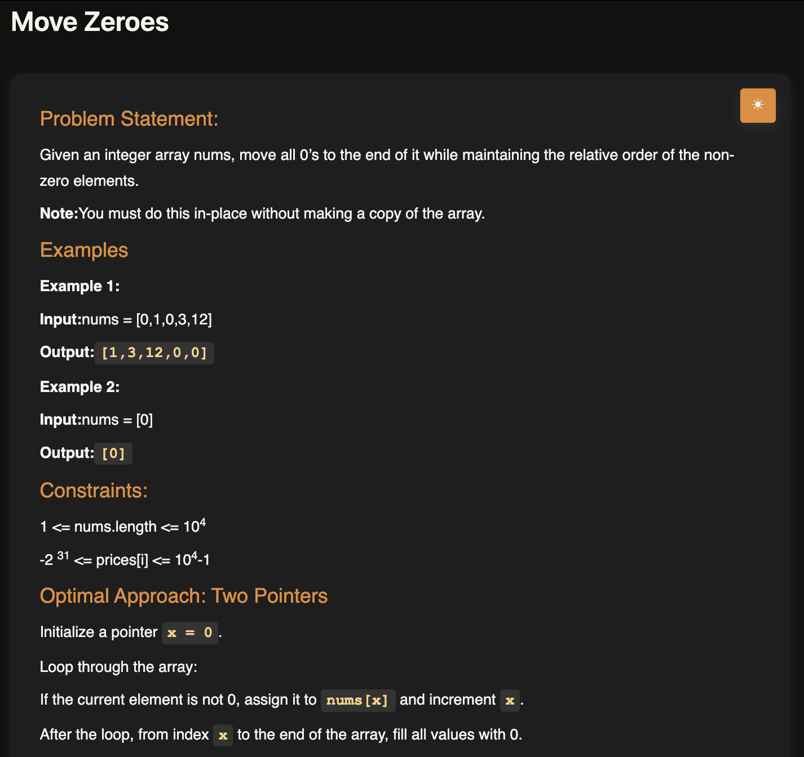
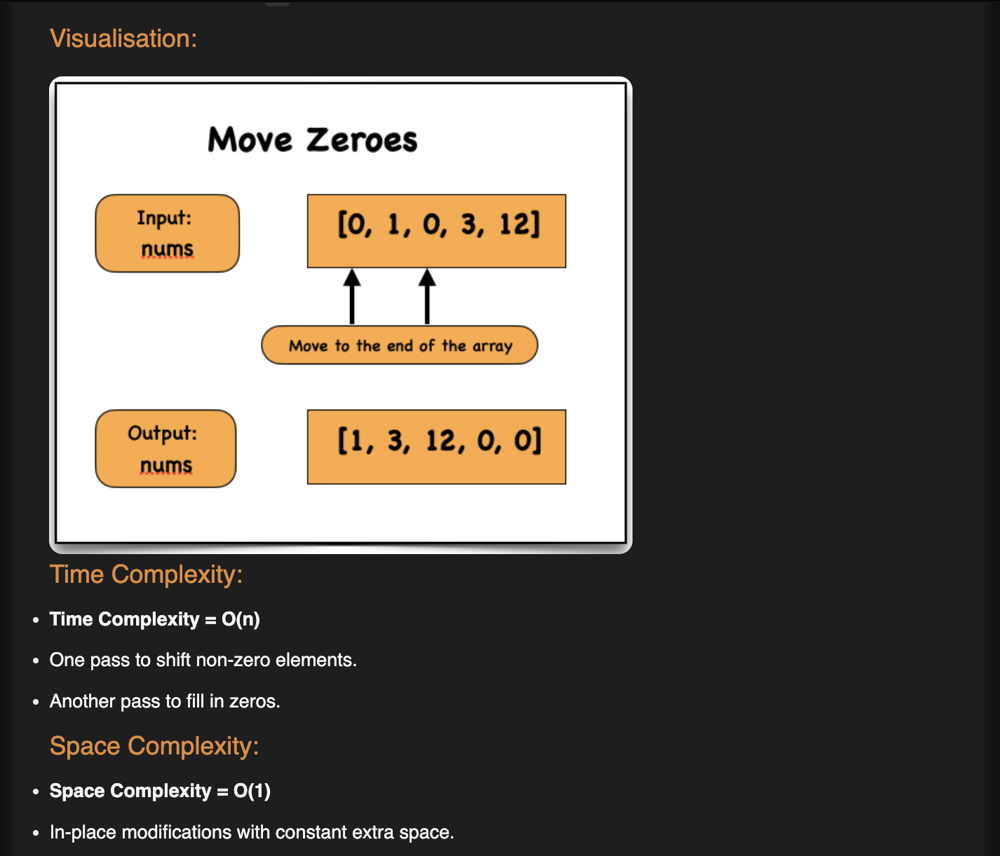
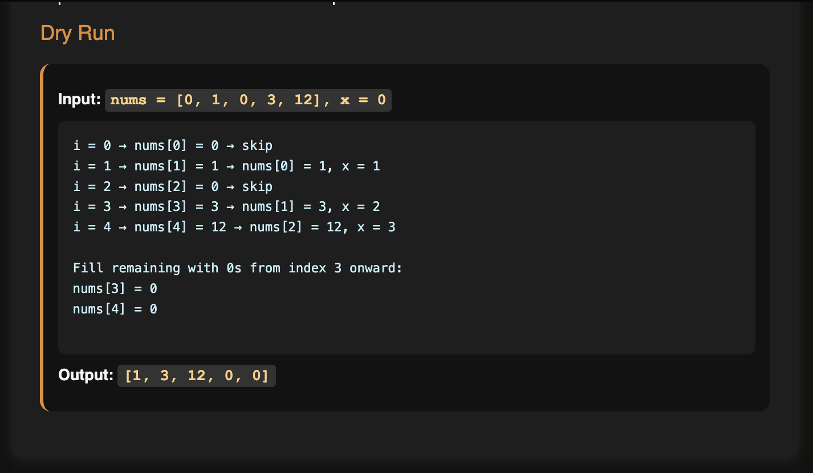

# Move Zeroes

**Topic:** Two Pointers · **Difficulty:** Easy

## Problem

Move every `0` in an array to the end, keeping the other values in their original order. Do it in place, without copying the array.







## Approach

**Pattern:** read/write pointers (same as [Remove Element](../02-remove-element), with `0` as the value to remove)

1. `x` is the **write** pointer: the next slot for a non-zero value. It starts at `0`.
2. `i` is the **read** pointer and scans the whole array. Every non-zero value is copied to `nums[x]`, then `x` moves on. Zeros are skipped.
3. After the loop, the first `x` slots hold the non-zeros in their original order. Fill every slot from `x` to the end with `0`.

`x` never gets ahead of `i`, so a value is always read before its slot is overwritten.

Dry run for `[0, 1, 0, 3, 12]`: skip 0 → write 1 at 0 → skip 0 → write 3 at 1 → write 12 at 2 → `x = 3`, fill indexes 3 and 4 with `0` → `[1, 3, 12, 0, 0]`

**Example:** `[0,1,0,3,12]` → `[1,3,12,0,0]`; `[0]` → `[0]`

## Complexity

- **Time:** O(n), one pass to shift the non-zeros and one to fill the zeros
- **Space:** O(1), in place

## Run

```bash
npx tsx solution.ts   # TypeScript
node solution.js      # JavaScript
```
